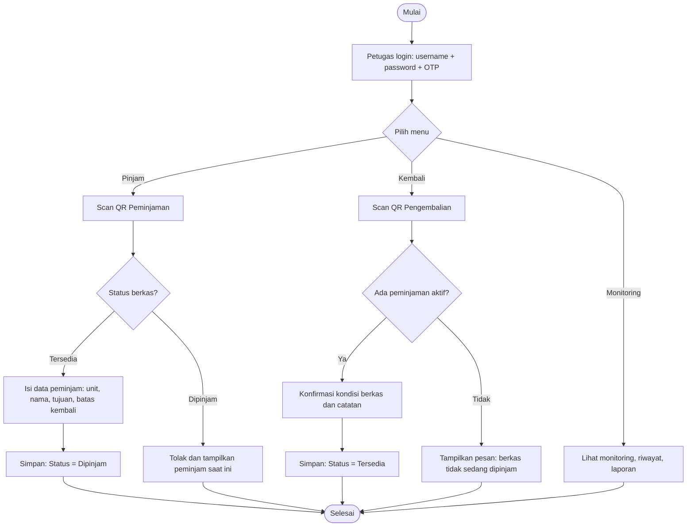
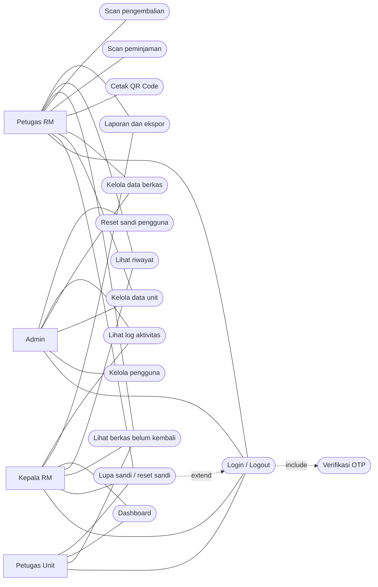
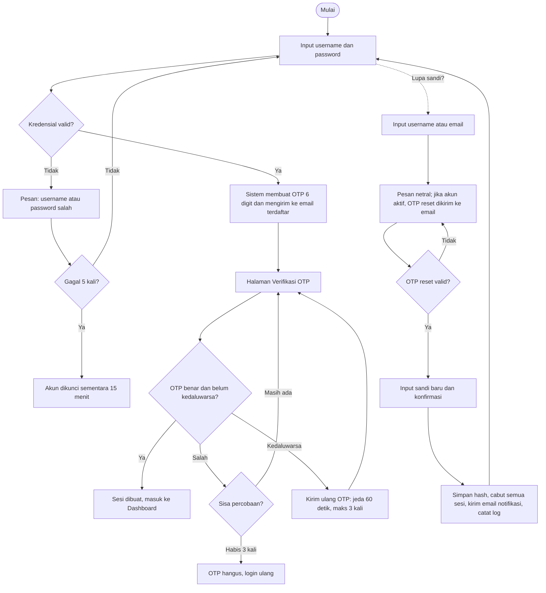
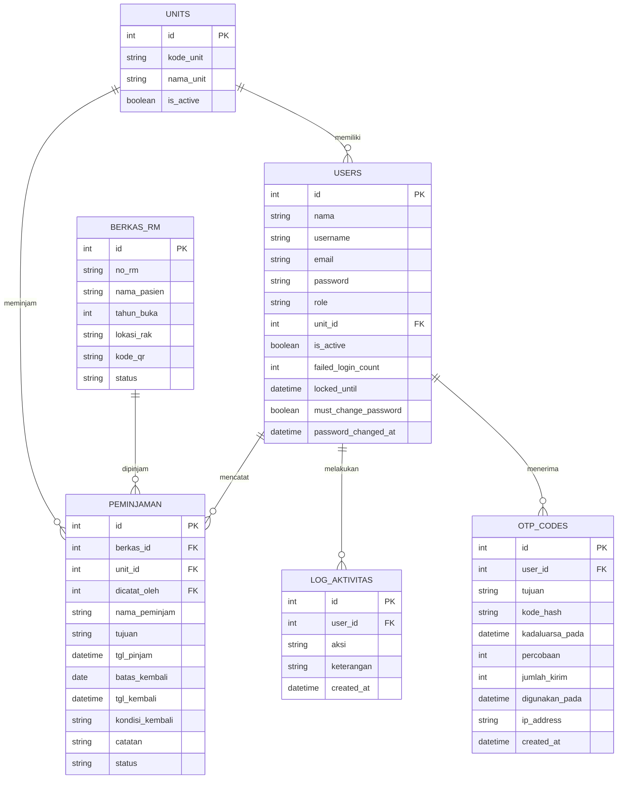

# PRODUCT REQUIREMENTS DOCUMENT (PRD)

## TRACKLY — Sistem Pelacakan dan Monitoring Peminjaman Berkas Rekam Medis Berbasis QR Code

**Tagline: *Track Every File, Improve Every Process.***

*Artinya: Lacak setiap berkas, tingkatkan setiap proses.*

*untuk Meningkatkan Efisiensi dan Ketepatan Pengelolaan Rekam Medis*

|                    |                                  |
|--------------------|----------------------------------|
| **Nama Produk**    | TRACKLY     |
| **Tagline**        | Track Every File, Improve Every Process. (Lacak setiap berkas, tingkatkan setiap proses.) |
| **Mata Kuliah**    | Pemrograman Web 2                |
| **Program Studi**  | D4 Manajemen Informasi Kesehatan |
| **Penyusun**       | 1. Alya Juni Enza<br>2. Bunga<br>3. Gina Indira Sanova<br>4. Nabila Islami<br>5. Rani Maha Putri<br>6. Yani Hafiza<br>7. Zakia Ilmi         |
| **Dosen Pengampu** | \[Nama Dosen\]                   |
| **Versi Dokumen**  | 1.3 (Draft Lengkap)              |
| **Tanggal**        | 20 Oktober 2026                  |

## Riwayat Revisi

| **Versi** | **Tanggal** | **Perubahan**                                                                                                             | **Penyusun** |
|-----------|-------------|---------------------------------------------------------------------------------------------------------------------------|--------------|
| 1.0       | 20 Okt 2026 | Penyusunan awal PRD                                                                                                       | Tim Penyusun     |
| 1.1       | 20 Okt 2026 | Penambahan diagram, wireframe, user story, aturan bisnis, spesifikasi QR/form, rute, pengujian, rilis, dan daftar pustaka | Tim Penyusun     |
| 1.2       | 20 Okt 2026 | Penggantian nama produk menjadi TRACKLY beserta tagline; penambahan verifikasi OTP saat login, fitur Lupa Sandi (reset sandi mandiri), reset sandi oleh Admin, serta penyesuaian aturan bisnis, form, data, UI, rute, keamanan, pengujian, dan risiko | Tim Penyusun     |
| 1.3       | 20 Okt 2026 | Penetapan OTP wajib untuk semua peran (Admin, Petugas RM, Petugas Unit, Kepala RM); pengisian nama tim penyusun | Tim Penyusun |

## Daftar Isi

- [1. Ringkasan Produk](#1-ringkasan-produk)
- [2. Latar Belakang dan Permasalahan](#2-latar-belakang-dan-permasalahan)
- [3. Tujuan Produk dan Indikator Keberhasilan](#3-tujuan-produk-dan-indikator-keberhasilan)
- [4. Ruang Lingkup](#4-ruang-lingkup)
- [5. Stakeholder dan Pengguna](#5-stakeholder-dan-pengguna)
- [6. User Stories](#6-user-stories)
- [7. Alur Bisnis dan Diagram](#7-alur-bisnis-dan-diagram)
  - [7.7 Alur Login dengan OTP dan Lupa Sandi](#77-alur-login-dengan-otp-dan-lupa-sandi)
- [8. Aturan Bisnis](#8-aturan-bisnis)
- [9. Kebutuhan Fungsional](#9-kebutuhan-fungsional)
  - [9.7 Verifikasi OTP dan Pemulihan Akun](#97-verifikasi-otp-dan-pemulihan-akun)
- [10. Spesifikasi QR Code dan Label](#10-spesifikasi-qr-code-dan-label)
- [11. Spesifikasi Form dan Validasi](#11-spesifikasi-form-dan-validasi)
  - [11.7 Form Verifikasi OTP](#117-form-verifikasi-otp-langkah-2-login-dan-lupa-sandi)
  - [11.8 Form Lupa Sandi dan 11.9 Form Sandi Baru](#118-form-lupa-sandi)
- [12. Kebutuhan Non-Fungsional](#12-kebutuhan-non-fungsional)
- [13. Hak Akses Berdasarkan Peran](#13-hak-akses-berdasarkan-peran)
- [14. Rancangan Data](#14-rancangan-data)
- [15. Rancangan Antarmuka (UI)](#15-rancangan-antarmuka-ui)
- [16. Rancangan Rute dan Endpoint Aplikasi](#16-rancangan-rute-dan-endpoint-aplikasi)
- [17. Arsitektur dan Rancangan Teknologi](#17-arsitektur-dan-rancangan-teknologi)
- [18. Keamanan dan Kepatuhan Data](#18-keamanan-dan-kepatuhan-data)
- [19. Rencana Pengujian](#19-rencana-pengujian)
- [20. Kriteria Penerimaan](#20-kriteria-penerimaan)
- [21. Rencana Rilis dan Timeline](#21-rencana-rilis-dan-timeline)
- [22. Risiko dan Mitigasi](#22-risiko-dan-mitigasi)
- [23. Asumsi, Ketergantungan, dan Batasan](#23-asumsi-ketergantungan-dan-batasan)
- [24. Pertanyaan Terbuka](#24-pertanyaan-terbuka)
- [25. Pengembangan Lanjutan](#25-pengembangan-lanjutan)
- [26. Glosarium](#26-glosarium)
- [27. Daftar Pustaka](#27-daftar-pustaka)
- [28. Persetujuan Dokumen](#28-persetujuan-dokumen)

---

## 1. Ringkasan Produk

TRACKLY adalah aplikasi berbasis web yang dapat diakses secara online untuk melacak lokasi dan memantau pergerakan berkas rekam medis (RM) fisik. Setiap berkas diberi QR Code sebagai identitas unik. Saat berkas dipinjam atau dikembalikan, petugas cukup memindai QR Code untuk mencatat unit peminjam, tanggal pinjam, dan tanggal kembali secara otomatis.

Sistem juga menyediakan daftar berkas yang belum dikembalikan, riwayat peminjaman, serta laporan monitoring untuk mengurangi risiko kehilangan berkas, mempercepat pencarian, dan meningkatkan ketertiban pengelolaan rekam medis.

Akses ke TRACKLY diamankan dengan verifikasi dua langkah: setelah memasukkan username dan password, pengguna wajib memasukkan kode OTP (One-Time Password) yang dikirim ke email terdaftar. Pengguna yang lupa sandi dapat mengatur ulang sandi sendiri melalui fitur Lupa Sandi yang juga diverifikasi dengan OTP, sedangkan Admin dapat membantu mereset sandi bila pengguna tidak dapat mengakses emailnya.

|                    |                                                                                                |
|--------------------|------------------------------------------------------------------------------------------------|
| **Jenis produk**   | Aplikasi web responsif (dapat dibuka dari komputer, tablet, dan ponsel)                        |
| **Pengguna utama** | Petugas rekam medis (filing), petugas unit peminjam, kepala rekam medis, admin                 |
| **Nilai utama**    | Lokasi berkas selalu diketahui, pencatatan cepat dan akurat, keterlambatan terdeteksi otomatis |
| **Pendekatan**     | Satu QR Code per berkas, pemindaian lewat kamera browser, data tersimpan terpusat di server    |

---

## 2. Latar Belakang dan Permasalahan

Di banyak fasilitas pelayanan kesehatan, peminjaman berkas rekam medis fisik masih dicatat secara manual (buku ekspedisi atau tracer kertas). Kondisi ini menimbulkan beberapa masalah:

| **No** | **Masalah**                                                       | **Dampak**                                |
|--------|-------------------------------------------------------------------|-------------------------------------------|
| 1      | Pencatatan manual rawan salah tulis, terlewat, atau tidak terbaca | Data peminjaman tidak akurat              |
| 2      | Lokasi berkas tidak diketahui secara real-time                    | Pencarian berkas lama, pelayanan tertunda |
| 3      | Tidak ada pengingat berkas yang belum kembali                     | Berkas hilang atau tertahan di unit lain  |
| 4      | Riwayat peminjaman sulit ditelusuri                               | Sulit audit dan akuntabilitas             |
| 5      | Rekap laporan dibuat manual                                       | Memakan waktu dan rawan kesalahan         |

Rekam medis wajib dijaga keutuhan, kerahasiaan, dan ketersediaannya (merujuk pada Permenkes No. 24 Tahun 2022 tentang Rekam Medis dan regulasi terkait perlindungan data pribadi). Oleh karena itu diperlukan sistem pelacakan yang tertib, cepat, dan dapat diaudit.

---

## 3. Tujuan Produk dan Indikator Keberhasilan

### 3.1 Tujuan Umum

Meningkatkan efisiensi dan ketepatan pengelolaan peminjaman berkas rekam medis melalui sistem pelacakan berbasis QR Code.

### 3.2 Tujuan Khusus

1.  Mencatat peminjaman dan pengembalian berkas secara cepat melalui pemindaian QR Code.
2.  Mengetahui lokasi dan status terkini setiap berkas RM.
3.  Menyediakan daftar berkas belum kembali beserta penanda keterlambatan.
4.  Menyimpan riwayat peminjaman yang lengkap dan dapat ditelusuri (audit trail).
5.  Menghasilkan laporan peminjaman secara otomatis.
6.  Mengamankan akses aplikasi melalui verifikasi OTP saat login dan menyediakan pemulihan sandi yang aman (Lupa Sandi).

### 3.3 Indikator Keberhasilan (Success Metrics)

| **Metrik**                                 | **Target** | **Cara Pengukuran**                                         |
|--------------------------------------------|------------|-------------------------------------------------------------|
| Waktu pencatatan satu transaksi peminjaman | ≤ 30 detik | Uji dengan stopwatch pada saat UAT (rata-rata 10 transaksi) |
| Waktu pencarian lokasi berkas              | ≤ 10 detik | Uji pencarian No. RM atau scan QR pada saat UAT             |
| Akurasi data peminjaman                    | ≥ 98%      | Bandingkan data sistem dengan berkas fisik pada sampel uji  |
| Berkas terlambat terdeteksi otomatis       | 100%       | Uji skenario batas kembali terlewati (TC-08)                |
| Skor kepuasan pengguna                     | ≥ 80%      | Kuesioner skala Likert pada saat UAT                        |
| Waktu proses login dua langkah (password + OTP) | ≤ 60 detik | Uji stopwatch pada saat UAT (rata-rata 10 percobaan) |
| Email OTP diterima pengguna | ≤ 30 detik (≥ 95% percobaan) | Uji kirim OTP 20 kali pada saat pengujian |
| Pemulihan sandi mandiri berhasil | 100% pada skenario uji | Uji TC-22 sampai TC-25 |

---

## 4. Ruang Lingkup

### 4.1 Dalam Lingkup (In Scope)

- Manajemen data berkas rekam medis (registrasi berkas).
- Pembuatan dan pencetakan QR Code per berkas.
- Pemindaian QR Code melalui kamera perangkat (scanner berbasis web).
- Pencatatan peminjaman dan pengembalian.
- Manajemen data unit/ruangan peminjam.
- Monitoring berkas belum kembali dan keterlambatan.
- Riwayat peminjaman per berkas dan per unit.
- Dashboard dan laporan (dapat diekspor ke PDF/Excel).
- Manajemen pengguna dan hak akses berbasis peran.
- Verifikasi dua langkah (OTP melalui email) saat login.
- Pemulihan akun: Lupa Sandi (reset mandiri dengan OTP), ubah sandi sendiri, dan reset sandi oleh Admin.

### 4.2 Di Luar Lingkup (Out of Scope)

- Penyimpanan isi/data klinis rekam medis (diagnosis, tindakan, dan sebagainya).
- Integrasi dengan SIMRS atau SATUSEHAT (dapat menjadi pengembangan lanjutan).
- Rekam medis elektronik (RME).
- Aplikasi mobile native (cukup web responsif).
- OTP melalui SMS/WhatsApp atau aplikasi authenticator (dapat menjadi pengembangan lanjutan).

---

## 5. Stakeholder dan Pengguna

### 5.1 Stakeholder

| **Stakeholder**            | **Kepentingan**                                  | **Keterlibatan**                                     |
|----------------------------|--------------------------------------------------|------------------------------------------------------|
| **Mahasiswa (pengembang)** | Menghasilkan aplikasi sesuai tugas mata kuliah   | Merancang, membangun, menguji, dan mendokumentasikan |
| **Dosen pengampu**         | Menilai kesesuaian rancangan dan hasil           | Mereviu dan menyetujui PRD                           |
| **Kepala/Koordinator RM**  | Pengelolaan berkas tertib dan dapat diaudit      | Pengguna laporan dan monitoring                      |
| **Petugas rekam medis**    | Pekerjaan pencatatan lebih cepat dan mudah       | Pengguna utama harian                                |
| **Unit peminjam**          | Berkas tersedia tepat waktu saat melayani pasien | Peminjam dan pemantau berkas unit sendiri            |

### 5.2 Peran Pengguna

| **Peran**                        | **Deskripsi**                                                          | **Kebutuhan Utama**                         |
|----------------------------------|------------------------------------------------------------------------|---------------------------------------------|
| **Admin Sistem**                 | Mengelola sistem dan akun pengguna                                     | Kelola pengguna, unit, dan pengaturan       |
| **Petugas Rekam Medis (Filing)** | Mengelola penyimpanan dan peminjaman berkas                            | Scan QR, catat pinjam/kembali, cari berkas  |
| **Petugas Unit / Peminjam**      | Perawat atau staf poli, ruangan, atau bagian lain yang meminjam berkas | Melihat status berkas yang dipinjam unitnya |
| **Kepala/Koordinator RM**        | Supervisor unit rekam medis                                            | Memantau dashboard dan laporan              |

### 5.3 Persona

|                          |                                                                                                                                                                                                                                                                  |
|--------------------------|------------------------------------------------------------------------------------------------------------------------------------------------------------------------------------------------------------------------------------------------------------------|
| **Ibu Sari, 34 tahun**   | Petugas Filing. Setiap hari melayani puluhan permintaan berkas dari poli dan ruang rawat. Masalah: sering harus mencari berkas yang tidak jelas ada di mana. Harapan: mencatat peminjaman tanpa menulis manual dan langsung tahu berkas mana yang belum kembali. |
| **Ns. Budi, 29 tahun**   | Perawat poli. Sering meminjam berkas untuk pasien kontrol. Masalah: tidak tahu apakah berkas sudah tersedia atau masih dipinjam unit lain. Harapan: dapat mengecek status berkas dari komputer di poli.                                                          |
| **Pak Hendra, 45 tahun** | Kepala Rekam Medis. Bertanggung jawab atas ketertiban berkas. Masalah: laporan peminjaman harus direkap manual. Harapan: dashboard dan laporan otomatis untuk bahan evaluasi.                                                                                    |

---

## 6. User Stories

| **ID** | **Sebagai**  | **Saya ingin**                                    | **Agar**                                          | **Prioritas** |
|--------|--------------|---------------------------------------------------|---------------------------------------------------|---------------|
| US-01  | Petugas RM   | login dengan akun pribadi                         | setiap aksi saya tercatat atas nama saya          | P1            |
| US-02  | Petugas RM   | mendaftarkan berkas baru dan mencetak QR Code-nya | berkas dapat dilacak sejak pertama dibuat         | P1            |
| US-03  | Petugas RM   | memindai QR Code untuk mencatat peminjaman        | pencatatan cepat tanpa menulis manual             | P1            |
| US-04  | Petugas RM   | memindai QR Code untuk mencatat pengembalian      | berkas kembali berstatus tersedia dengan benar    | P1            |
| US-05  | Petugas RM   | mencari berkas dengan No. RM jika QR rusak        | pekerjaan tidak terhenti                          | P1            |
| US-06  | Petugas RM   | melihat daftar berkas yang belum kembali          | dapat menagih berkas ke unit terkait              | P1            |
| US-07  | Petugas RM   | melihat riwayat peminjaman suatu berkas           | dapat menelusuri siapa saja yang pernah meminjam  | P1            |
| US-08  | Petugas Unit | melihat status berkas yang dipinjam unit saya     | tahu berkas mana yang harus dikembalikan          | P1            |
| US-09  | Kepala RM    | melihat dashboard ringkasan                       | memantau kondisi pengelolaan berkas sekilas       | P1            |
| US-10  | Kepala RM    | mengunduh laporan peminjaman                      | dapat digunakan sebagai bahan evaluasi dan audit  | P2            |
| US-11  | Admin        | mengelola akun pengguna dan hak aksesnya          | hanya orang berwenang yang dapat mengakses data   | P1            |
| US-12  | Admin        | mengatur durasi standar peminjaman                | aturan batas kembali sesuai kebijakan fasilitas   | P2            |
| US-13  | Admin        | melihat log aktivitas pengguna                    | dapat mengaudit perubahan data                    | P2            |
| US-14  | Petugas RM   | mengimpor data berkas dari Excel                  | tidak perlu menginput ribuan berkas satu per satu | P3            |
| US-15  | Semua pengguna | memasukkan kode OTP yang dikirim ke email setelah login | akun saya tetap aman walau password diketahui orang lain | P1 |
| US-16  | Semua pengguna | mengatur ulang sandi sendiri lewat fitur Lupa Sandi | saya dapat masuk kembali tanpa harus menunggu Admin | P1 |
| US-17  | Admin        | mereset sandi pengguna yang tidak bisa mengakses emailnya | pengguna tetap bisa bekerja dengan aman | P1 |
| US-18  | Semua pengguna | mengirim ulang OTP bila belum diterima atau kedaluwarsa | login tidak terhenti | P1 |

---

## 7. Alur Bisnis dan Diagram

### 7.1 Peminjaman Berkas

- Petugas Filing membuka halaman Scan Peminjaman.
- Petugas memindai QR Code pada berkas.
- Sistem menampilkan data berkas dan statusnya (Tersedia/Dipinjam).
- Jika Tersedia, petugas memilih unit peminjam, mengisi nama peminjam, tujuan, dan batas tanggal kembali.
- Petugas menyimpan. Status berkas berubah menjadi Dipinjam dan tanggal pinjam tercatat otomatis.

### 7.2 Pengembalian Berkas

- Petugas memindai QR Code berkas yang dikembalikan.
- Sistem menampilkan data peminjaman aktif.
- Petugas mengonfirmasi kondisi berkas (lengkap/tidak lengkap) lalu menyimpan.
- Status berubah menjadi Tersedia dan tanggal kembali tercatat otomatis.

### 7.3 Monitoring

- Sistem menandai berkas yang melewati batas waktu sebagai Terlambat.
- Petugas atau Kepala melihat daftar berkas belum kembali di dashboard.
- Riwayat dan laporan dapat difilter berdasarkan tanggal, unit, dan status.

### 7.4 Diagram Alur Proses

> Diagram pada dokumen ini ditulis dengan Mermaid. Dapat dirender di GitHub, GitLab, VS Code (ekstensi Markdown Mermaid), Obsidian, atau Typora.



*Gambar 1. Diagram alur peminjaman, pengembalian, dan monitoring*

### 7.5 Siklus Status Berkas

| **Kondisi Awal**           | **Aksi**                                         | **Hasil**                                     |
|----------------------------|--------------------------------------------------|-----------------------------------------------|
| **Tersedia**               | Scan QR di menu Peminjaman, isi data, simpan     | Status Dipinjam; tgl pinjam tercatat          |
| **Dipinjam**               | Scan QR di menu Peminjaman                       | Ditolak; sistem menampilkan peminjam saat ini |
| **Dipinjam**               | Scan QR di menu Pengembalian, konfirmasi kondisi | Status Tersedia; tgl kembali tercatat         |
| **Dipinjam (lewat batas)** | Dicek otomatis oleh sistem                       | Ditandai Terlambat di daftar dan dashboard    |

### 7.6 Diagram Use Case



*Gambar 2. Diagram use case berdasarkan peran pengguna*


### 7.7 Alur Login dengan OTP dan Lupa Sandi

**Login dua langkah**

- Langkah 1: pengguna memasukkan username dan password di halaman Login.
- Jika valid, sistem membuat kode OTP 6 digit, mengirimkannya ke email terdaftar, lalu membuka halaman Verifikasi OTP (alamat email ditampilkan sebagian, misalnya s*****@gmail.com). Sesi belum dibuat pada tahap ini.
- Langkah 2: pengguna memasukkan OTP dalam 5 menit. Jika benar, sesi dibuat dan pengguna masuk ke Dashboard.
- OTP salah 3 kali membuat OTP hangus dan pengguna harus login ulang. OTP kedaluwarsa atau belum diterima dapat dikirim ulang (jeda 60 detik, maksimal 3 kali).

**Lupa sandi**

- Dari halaman Login, pengguna memilih tautan "Lupa sandi?" lalu memasukkan username atau email.
- Sistem selalu menampilkan pesan netral ("Jika akun terdaftar, kode verifikasi telah dikirim ke email Anda"). Bila akun ditemukan dan aktif, OTP reset dikirim ke email terdaftar.
- Setelah OTP reset benar, pengguna diarahkan ke halaman Sandi Baru (berlaku 10 menit, sekali pakai), memasukkan sandi baru dan konfirmasi.
- Sandi baru disimpan dalam bentuk hash, seluruh sesi lama dicabut, email pemberitahuan keamanan dikirim, dan kejadian dicatat di log. Pengguna kemudian login kembali (dengan OTP).
- Bila email tidak dapat diakses, pengguna menghubungi Admin yang dapat mereset sandi (sandi sementara, wajib diganti saat login berikutnya).



*Gambar 2a. Diagram alur login dengan OTP dan Lupa Sandi*

| **Parameter**                | **Nilai Bawaan**                                       |
|------------------------------|--------------------------------------------------------|
| Panjang OTP                  | 6 digit numerik, dibuat dengan generator acak aman     |
| Masa berlaku OTP             | 5 menit, sekali pakai                                  |
| Batas salah per OTP          | 3 kali, lalu OTP hangus                                |
| Kirim ulang OTP              | Jeda 60 detik, maksimal 3 kali per proses login        |
| Masa berlaku token reset sandi | 10 menit, sekali pakai                               |
| Penguncian akun              | 15 menit setelah 5 kali password salah                 |
| Batas permintaan Lupa Sandi  | Maksimal 5 permintaan per jam per akun dan per alamat IP |

---

## 8. Aturan Bisnis

| **ID** | **Aturan**                                                                                                                                         |
|--------|----------------------------------------------------------------------------------------------------------------------------------------------------|
| BR-01  | Satu berkas hanya boleh memiliki satu peminjaman aktif pada satu waktu.                                                                            |
| BR-02  | Hanya Petugas RM dan Admin yang boleh mencatat peminjaman dan pengembalian.                                                                        |
| BR-03  | Batas waktu pengembalian bawaan adalah 2 hari sejak tanggal pinjam (dapat diubah Admin). Batas kembali tidak boleh lebih awal dari tanggal pinjam. |
| BR-04  | Berkas dinyatakan Terlambat secara otomatis jika tanggal hari ini melewati batas kembali dan berkas belum dikembalikan.                            |
| BR-05  | Saat pengembalian, kondisi berkas wajib dipilih. Jika kondisi "tidak lengkap", catatan wajib diisi.                                                |
| BR-06  | Data berkas, unit, dan pengguna yang sudah memiliki transaksi tidak dihapus permanen, hanya dinonaktifkan (soft delete).                           |
| BR-07  | Transaksi yang sudah selesai tidak dapat diubah. Koreksi hanya dapat dilakukan Admin dan tercatat di log aktivitas.                                |
| BR-08  | QR Code hanya berisi kode acak berkas. Tidak ada data pasien di dalam QR Code.                                                                     |
| BR-09  | Satu berkas memiliki satu QR Code aktif. Jika QR dibuat ulang, kode lama otomatis tidak berlaku.                                                   |
| BR-10  | Nama pasien ditampilkan sebagian (disamarkan) pada halaman yang diakses Petugas Unit dan pada laporan ringkasan.                                   |
| BR-11  | Peran Kepala RM hanya memiliki akses lihat (read-only), tidak dapat mengubah data transaksi.                                                       |
| BR-12  | Sesi pengguna berakhir otomatis setelah 30 menit tanpa aktivitas.                                                                                  |
| BR-13  | Login wajib dua langkah untuk semua peran (Admin, Petugas RM, Petugas Unit, Kepala RM): (1) username dan password, (2) kode OTP. Sesi hanya dibuat setelah OTP valid. |
| BR-14  | OTP terdiri dari 6 digit numerik acak, berlaku 5 menit, hanya dapat dipakai sekali, dan disimpan dalam bentuk hash (bukan teks asli). |
| BR-15  | OTP salah 3 kali membuat OTP hangus. Kirim ulang dibatasi jeda 60 detik dan maksimal 3 kali per proses login. OTP baru membuat OTP lama otomatis tidak berlaku. |
| BR-16  | OTP hanya dikirim ke email terdaftar milik pengguna. Email wajib diisi dan unik per pengguna, serta ditampilkan sebagian pada layar. |
| BR-17  | Lupa Sandi diverifikasi dengan OTP. Respons sistem selalu netral sehingga tidak membocorkan apakah username/email terdaftar. Maksimal 5 permintaan per jam per akun dan per alamat IP. |
| BR-18  | Sandi baru minimal 8 karakter, mengandung huruf dan angka, dan tidak boleh sama dengan sandi saat ini. Setelah sandi diubah/direset, semua sesi aktif pengguna dicabut. |
| BR-19  | Admin dapat mereset sandi pengguna lain dengan sandi sementara acak. Pengguna wajib menggantinya saat login berikutnya. Admin tidak dapat melihat sandi pengguna. Aksi tercatat di log aktivitas. |
| BR-20  | Akun dikunci sementara 15 menit setelah 5 kali password salah berturut-turut. |

---

## 9. Kebutuhan Fungsional

*Prioritas: P1 = wajib (MVP), P2 = penting, P3 = opsional.*

### 9.1 Autentikasi dan Manajemen Pengguna

| **ID** | **Kebutuhan**                                                                           | **Prioritas** |
|--------|-----------------------------------------------------------------------------------------|---------------|
| FR-01  | Pengguna dapat login (langkah 1: username dan password, dilanjutkan verifikasi OTP pada FR-30 s.d. FR-32) dan logout                            | P1            |
| FR-02  | Sistem menerapkan hak akses berdasarkan peran (Admin, Petugas RM, Petugas Unit, Kepala) | P1            |
| FR-03  | Admin dapat menambah, mengubah, dan menonaktifkan akun                                  | P1            |
| FR-04  | Pengguna dapat mengubah password sendiri (memasukkan sandi lama dan sandi baru; juga dipakai saat wajib ganti sandi setelah reset Admin) | P1            |

### 9.2 Manajemen Data Berkas Rekam Medis

| **ID** | **Kebutuhan**                                                                                           | **Prioritas** |
|--------|---------------------------------------------------------------------------------------------------------|---------------|
| FR-05  | Petugas dapat menambah, mengubah, dan melihat data berkas (No. RM, nama pasien, tahun buka, lokasi rak) | P1            |
| FR-06  | Sistem membuat QR Code unik otomatis untuk setiap berkas                                                | P1            |
| FR-07  | Petugas dapat mencetak QR Code (label) satuan maupun massal                                             | P1            |
| FR-08  | Pencarian, filter, pengurutan, dan paginasi data berkas berdasarkan No. RM, nama, status, dan lokasi    | P1            |
| FR-09  | Impor data berkas dari file Excel/CSV                                                                   | P3            |
| FR-10  | Admin dapat membuat ulang QR Code berkas (kode lama tidak berlaku)                                      | P2            |

### 9.3 Manajemen Unit Peminjam

| **ID** | **Kebutuhan**                                                                           | **Prioritas** |
|--------|-----------------------------------------------------------------------------------------|---------------|
| FR-11  | Admin/Petugas dapat mengelola data unit (Poli, IGD, Rawat Inap, Penunjang, dan lainnya) | P1            |

### 9.4 Peminjaman dan Pengembalian

| **ID** | **Kebutuhan**                                                                                        | **Prioritas** |
|--------|------------------------------------------------------------------------------------------------------|---------------|
| FR-12  | Sistem dapat memindai QR Code menggunakan kamera perangkat                                           | P1            |
| FR-13  | Alternatif input manual No. RM bila QR Code rusak atau tidak terbaca                                 | P1            |
| FR-14  | Pencatatan peminjaman: berkas, unit, nama peminjam, tujuan, tanggal pinjam (otomatis), batas kembali | P1            |
| FR-15  | Sistem menolak peminjaman jika berkas berstatus Dipinjam                                             | P1            |
| FR-16  | Pencatatan pengembalian: tanggal kembali (otomatis), kondisi berkas, catatan                         | P1            |
| FR-17  | Status berkas berubah otomatis (Tersedia dan Dipinjam)                                               | P1            |
| FR-18  | Perpanjangan masa peminjaman                                                                         | P3            |
| FR-19  | Koreksi transaksi oleh Admin disertai alasan dan tercatat di log                                     | P3            |

### 9.5 Monitoring dan Riwayat

| **ID** | **Kebutuhan**                                                                                     | **Prioritas** |
|--------|---------------------------------------------------------------------------------------------------|---------------|
| FR-20  | Daftar berkas belum dikembalikan lengkap dengan lama peminjaman (hari)                            | P1            |
| FR-21  | Penanda visual untuk berkas terlambat (melewati batas kembali)                                    | P1            |
| FR-22  | Riwayat peminjaman per berkas                                                                     | P1            |
| FR-23  | Riwayat peminjaman per unit dan per periode                                                       | P2            |
| FR-24  | Dashboard ringkasan: total berkas, sedang dipinjam, terlambat, peminjaman hari ini, grafik 7 hari | P1            |
| FR-25  | Notifikasi/pengingat keterlambatan di dashboard                                                   | P2            |

### 9.6 Laporan, Pengaturan, dan Audit

| **ID** | **Kebutuhan**                                                    | **Prioritas** |
|--------|------------------------------------------------------------------|---------------|
| FR-26  | Laporan peminjaman berdasarkan rentang tanggal, unit, dan status | P2            |
| FR-27  | Ekspor laporan ke PDF dan Excel                                  | P2            |
| FR-28  | Log aktivitas pengguna (audit trail)                             | P2            |
| FR-29  | Pengaturan durasi standar peminjaman oleh Admin                  | P2            |

### 9.7 Verifikasi OTP dan Pemulihan Akun

| **ID** | **Kebutuhan**                                                                                                         | **Prioritas** |
|--------|-----------------------------------------------------------------------------------------------------------------------|---------------|
| FR-30  | Setelah username dan password valid, sistem mengirim OTP 6 digit ke email terdaftar dan membuka halaman Verifikasi OTP | P1            |
| FR-31  | Sistem memverifikasi OTP (berlaku 5 menit, sekali pakai, maksimal 3 kali salah) sebelum membuat sesi                    | P1            |
| FR-32  | Tombol Kirim Ulang OTP dengan hitung mundur 60 detik dan batas 3 kali per proses login                                  | P1            |
| FR-33  | Tautan Lupa Sandi di halaman Login: input username/email, verifikasi OTP, lalu buat sandi baru                          | P1            |
| FR-34  | Reset sandi memakai token sekali pakai (10 menit), validasi kekuatan sandi, penyimpanan hash, dan pencabutan sesi lama   | P1            |
| FR-35  | Email pemberitahuan keamanan setelah sandi diubah atau direset                                                          | P2            |
| FR-36  | Admin dapat mereset sandi pengguna (sandi sementara, wajib diganti saat login berikutnya)                               | P1            |
| FR-37  | Pembatasan laju (rate limiting) permintaan OTP dan Lupa Sandi serta penguncian sementara akun                           | P1            |
| FR-38  | Pencatatan log: OTP terkirim, OTP berhasil/gagal, permintaan Lupa Sandi, dan reset sandi                                | P2            |
| FR-39  | Pengguna dapat mengubah email terdaftar dengan verifikasi OTP ke email baru                                             | P3            |


---

## 10. Spesifikasi QR Code dan Label

| **Aspek**                   | **Spesifikasi**                                                                                                                  |
|-----------------------------|----------------------------------------------------------------------------------------------------------------------------------|
| **Isi QR Code**             | Alamat URL pendek berisi kode acak, contoh: https://domain-aplikasi/scan/{kode_qr}. Tidak memuat nama, No. RM, atau data pasien. |
| **Format kode_qr**          | String acak unik (UUID atau 16 karakter alfanumerik), disimpan di kolom kode_qr pada tabel berkas_rm.                            |
| **Level koreksi kesalahan** | Level M (sekitar 15%) atau Q (sekitar 25%) agar tetap terbaca jika label sedikit rusak.                                          |
| **Ukuran label**            | Sekitar 3 × 3 cm (area QR minimal 2,5 × 2,5 cm). Teks No. RM dicetak di bawah QR Code.                                           |
| **Resolusi cetak**          | Minimal 300 dpi, warna hitam di atas latar putih.                                                                                |
| **Media cetak**             | Kertas stiker label (disarankan tahan air) atau dilaminasi.                                                                      |
| **Penempatan**              | Pada sampul depan map/odner berkas, di posisi yang sama untuk semua berkas.                                                      |
| **Cetak massal**            | Halaman cetak PDF berisi banyak label per lembar, menyesuaikan ukuran kertas label.                                              |
| **Perilaku saat dipindai**  | Jika dipindai dengan aplikasi kamera biasa, URL membuka halaman login. Data tidak tampil tanpa login dan hak akses yang sesuai.  |
| **QR rusak/hilang**         | Gunakan input manual No. RM, lalu cetak ulang label (Admin dapat membuat ulang kode).                                            |

---

## 11. Spesifikasi Form dan Validasi

### 11.1 Form Login (Langkah 1: Username dan Password)

| **Field** | **Tipe Input** | **Wajib** | **Aturan Validasi**                                                      |
|-----------|----------------|-----------|--------------------------------------------------------------------------|
| username  | Teks           | Ya        | Maksimal 50 karakter                                                     |
| password  | Password       | Ya        | Minimal 8 karakter; maksimal 5 percobaan gagal sebelum dikunci sementara 15 menit |

### 11.2 Form Data Berkas RM

| **Field**   | **Tipe Input** | **Wajib** | **Aturan Validasi**                                      |
|-------------|----------------|-----------|----------------------------------------------------------|
| no_rm       | Teks           | Ya        | Unik; hanya angka dan tanda hubung; maksimal 20 karakter |
| nama_pasien | Teks           | Ya        | Maksimal 100 karakter                                    |
| tahun_buka  | Angka          | Ya        | 4 digit; tidak boleh lebih dari tahun berjalan           |
| lokasi_rak  | Teks           | Ya        | Maksimal 30 karakter                                     |

### 11.3 Form Peminjaman

| **Field**     | **Tipe Input**       | **Wajib** | **Aturan Validasi**                                                                              |
|---------------|----------------------|-----------|--------------------------------------------------------------------------------------------------|
| berkas        | Hasil scan/pencarian | Ya        | Berkas harus terdaftar dan berstatus Tersedia                                                    |
| unit_id       | Pilihan (select)     | Ya        | Harus unit aktif                                                                                 |
| nama_peminjam | Teks                 | Ya        | Maksimal 100 karakter                                                                            |
| tujuan        | Pilihan (select)     | Ya        | Pelayanan pasien, Kontrol/Poli, Klaim/Asuransi, Audit/Akreditasi, Penelitian/Pendidikan, Lainnya |
| batas_kembali | Tanggal              | Ya        | Tidak boleh sebelum hari ini; nilai awal = hari ini + durasi standar                             |

### 11.4 Form Pengembalian

| **Field**       | **Tipe Input**  | **Wajib**   | **Aturan Validasi**                                     |
|-----------------|-----------------|-------------|---------------------------------------------------------|
| kondisi_kembali | Pilihan (radio) | Ya          | Lengkap atau Tidak lengkap                              |
| catatan         | Teks panjang    | Kondisional | Wajib jika kondisi tidak lengkap; maksimal 255 karakter |

### 11.5 Form Unit dan Pengguna

| **Field**           | **Tipe Input**   | **Wajib**   | **Aturan Validasi**                     |
|---------------------|------------------|-------------|-----------------------------------------|
| kode_unit           | Teks             | Ya          | Unik; maksimal 10 karakter              |
| nama_unit           | Teks             | Ya          | Maksimal 100 karakter                   |
| nama (pengguna)     | Teks             | Ya          | Maksimal 100 karakter                   |
| username (pengguna) | Teks             | Ya          | Unik; maksimal 50 karakter              |
| email (pengguna)    | Email            | Ya          | Format email valid; unik; maksimal 100 karakter; dipakai untuk OTP dan pemulihan sandi |
| password (pengguna) | Password         | Ya          | Minimal 8 karakter, mengandung huruf dan angka (pengguna wajib menggantinya saat login pertama) |
| role                | Pilihan (select) | Ya          | admin, petugas_rm, petugas_unit, kepala |
| unit_id (pengguna)  | Pilihan (select) | Kondisional | Wajib jika role = petugas_unit          |

### 11.6 Penanganan Kesalahan dan Pesan Sistem

| **Kondisi**                                 | **Pesan/Perilaku Sistem**                                                     |
|---------------------------------------------|-------------------------------------------------------------------------------|
| QR Code tidak dikenali                      | "QR Code tidak terdaftar. Coba input manual No. RM."                          |
| Berkas sedang dipinjam (saat pinjam)        | "Berkas sedang dipinjam oleh \[unit\] sejak \[tanggal\]." Form disabled.      |
| Berkas tidak sedang dipinjam (saat kembali) | "Berkas ini tidak sedang dipinjam."                                           |
| Izin kamera ditolak                         | "Izin kamera diperlukan. Aktifkan izin kamera atau gunakan input manual."     |
| Sesi habis                                  | Pengguna diarahkan ke halaman login dengan pemberitahuan sesi berakhir.       |
| Akses tanpa izin                            | Halaman 403 "Anda tidak memiliki akses ke halaman ini."                       |
| Kegagalan penyimpanan                       | Pesan galat umum tanpa membuka detail teknis; kejadian dicatat di log server. |
| Username/password salah | "Username atau password salah." (tidak menyebutkan mana yang salah) |
| Akun terkunci | "Akun dikunci sementara karena terlalu banyak percobaan gagal. Coba lagi dalam 15 menit." |
| OTP salah | "Kode OTP salah. Sisa percobaan: [n]." |
| OTP kedaluwarsa | "Kode OTP sudah kedaluwarsa. Silakan kirim ulang kode." |
| Percobaan OTP habis | "Percobaan habis. Silakan login ulang." |
| Kirim ulang terlalu cepat | "Tunggu [n] detik sebelum mengirim ulang kode." |
| Lupa sandi (hasil apa pun) | "Jika akun terdaftar, kode verifikasi telah dikirim ke email Anda." |
| Reset sandi berhasil | "Sandi berhasil diubah. Silakan login kembali." |
| Email gagal terkirim | "Kode belum dapat dikirim. Coba lagi atau hubungi Admin." (kejadian dicatat di log server) |

### 11.7 Form Verifikasi OTP (Langkah 2 Login dan Lupa Sandi)

| **Field** | **Tipe Input**          | **Wajib** | **Aturan Validasi**                                                             |
|-----------|-------------------------|-----------|---------------------------------------------------------------------------------|
| kode_otp  | Angka (6 kotak digit)   | Ya        | Tepat 6 digit angka; masih berlaku (5 menit); belum dipakai; maksimal 3 kali salah |

### 11.8 Form Lupa Sandi

| **Field**        | **Tipe Input** | **Wajib** | **Aturan Validasi**                                              |
|------------------|----------------|-----------|------------------------------------------------------------------|
| username_or_email | Teks          | Ya        | Maksimal 100 karakter; respons selalu netral; dibatasi 5 permintaan per jam |

### 11.9 Form Sandi Baru

| **Field**             | **Tipe Input** | **Wajib** | **Aturan Validasi**                                                                  |
|-----------------------|----------------|-----------|--------------------------------------------------------------------------------------|
| password_baru         | Password       | Ya        | Minimal 8 karakter, mengandung huruf dan angka; tidak boleh sama dengan sandi saat ini |
| konfirmasi_password   | Password       | Ya        | Harus sama dengan password_baru                                                      |
| token_reset (tersembunyi) | Token      | Ya        | Valid, belum dipakai, belum lewat 10 menit                                            |

---

## 12. Kebutuhan Non-Fungsional

| **Kategori**       | **Kebutuhan**                                                                                                                |
|--------------------|------------------------------------------------------------------------------------------------------------------------------|
| **Keamanan**       | Password di-hash (bcrypt/Argon2); proteksi terhadap SQL Injection, XSS, dan CSRF; sesi dengan batas waktu; menggunakan HTTPS |
| **Autentikasi** | Verifikasi dua langkah (password + OTP email); OTP 6 digit, berlaku 5 menit, sekali pakai, disimpan ter-hash; pemulihan sandi mandiri; pembatasan laju; email OTP terkirim ≤ 30 detik |
| **OTP (verifikasi dua langkah)** | OTP 6 digit acak, berlaku 5 menit, sekali pakai, disimpan ter-hash; maksimal 3 percobaan salah; kirim ulang dibatasi; sesi baru dibuat hanya setelah OTP valid; OTP tidak pernah dicatat di log |
| **Pemulihan sandi** | Respons netral (anti-enumerasi akun); OTP dikirim hanya ke email terdaftar; token reset sekali pakai 10 menit; sandi baru di-hash; semua sesi lama dicabut; email pemberitahuan keamanan |
| **Pembatasan laju dan penguncian** | Throttle pada login, OTP, dan Lupa Sandi (per akun dan per IP); akun dikunci 15 menit setelah 5 kali password salah; semua kejadian tercatat di log aktivitas |
| **Privasi**        | QR Code hanya memuat kode berkas, bukan data pasien. Data pasien yang tampil dibatasi seminimal mungkin                      |
| **Kinerja**        | Halaman utama dimuat ≤ 3 detik; hasil scan diproses ≤ 2 detik; mendukung minimal 20 pengguna bersamaan                       |
| **Ketersediaan**   | Dapat diakses online 24/7 (target uptime ≥ 99%)                                                                              |
| **Kompatibilitas** | Responsif di desktop, tablet, dan ponsel; mendukung Chrome, Edge, Firefox, dan Safari versi terbaru                          |
| **Usability**      | Antarmuka sederhana berbahasa Indonesia; maksimal 3 klik untuk mencatat peminjaman                                           |
| **Auditabilitas**  | Setiap transaksi mencatat pengguna dan waktu (timestamp)                                                                     |
| **Skalabilitas**   | Struktur data mampu menampung puluhan ribu berkas dan ratusan ribu transaksi                                                 |
| **Backup**         | Pencadangan basis data berkala (minimal harian)                                                                              |
| **Pemeliharaan**   | Kode terstruktur (pola MVC), terdokumentasi, dan dikelola dengan Git                                                         |

---

## 13. Hak Akses Berdasarkan Peran

| **Fitur**                              | **Admin** | **Petugas RM** | **Petugas Unit** | **Kepala RM** |
|----------------------------------------|-----------|----------------|------------------|---------------|
| **Kelola pengguna**                    | Penuh     | \-             | \-               | \-            |
| **Reset sandi pengguna lain**          | Penuh     | \-             | \-               | \-            |
| **Login OTP, Lupa Sandi, ubah sandi sendiri** | Penuh | Penuh      | Penuh            | Penuh         |
| **Kelola data berkas dan QR**          | Penuh     | Penuh          | \-               | Lihat         |
| **Kelola data unit**                   | Penuh     | Penuh          | \-               | \-            |
| **Catat peminjaman/pengembalian**      | Penuh     | Penuh          | \-               | \-            |
| **Lihat berkas dipinjam unit sendiri** | Penuh     | Penuh          | Penuh            | Penuh         |
| **Dashboard dan monitoring**           | Penuh     | Penuh          | Terbatas         | Penuh         |
| **Laporan dan ekspor**                 | Penuh     | Penuh          | \-               | Penuh         |
| **Pengaturan sistem**                  | Penuh     | \-             | \-               | \-            |
| **Log aktivitas**                      | Penuh     | \-             | \-               | Lihat         |

*Keterangan: Penuh = akses penuh; Lihat = hanya melihat; Terbatas = sebatas data unit sendiri; tanda "-" = tidak ada akses.*

---

## 14. Rancangan Data

### 14.1 Entity Relationship Diagram (ERD)



*Gambar 3. ERD sistem pelacakan peminjaman berkas rekam medis*

### 14.2 Entitas dan Atribut

#### Tabel users

| **Field** | **Tipe**            | **Keterangan**                          |
|-----------|---------------------|-----------------------------------------|
| id        | INT (PK)            | Identitas pengguna                      |
| nama      | VARCHAR(100)        | Nama lengkap                            |
| username  | VARCHAR(50), unique | Nama login                              |
| email | VARCHAR(100), unique | Email aktif untuk OTP dan pemulihan sandi |
| password  | VARCHAR(255)        | Disimpan dalam bentuk hash              |
| role      | ENUM                | admin, petugas_rm, petugas_unit, kepala |
| unit_id   | INT (FK, nullable)  | Unit asal pengguna                      |
| is_active | BOOLEAN             | Status akun aktif/nonaktif              |
| failed_login_count | INT | Jumlah password salah berturut-turut (direset saat login berhasil) |
| locked_until | DATETIME (nullable) | Waktu akun terbuka kembali setelah penguncian sementara |
| must_change_password | BOOLEAN | Bernilai benar setelah reset oleh Admin; pengguna wajib mengganti sandi |
| password_changed_at | DATETIME (nullable) | Waktu sandi terakhir diubah |

#### Tabel units

| **Field** | **Tipe**            | **Keterangan**             |
|-----------|---------------------|----------------------------|
| id        | INT (PK)            | Identitas unit             |
| kode_unit | VARCHAR(10), unique | Kode unit                  |
| nama_unit | VARCHAR(100)        | Nama unit/ruangan          |
| is_active | BOOLEAN             | Status unit aktif/nonaktif |

#### Tabel berkas_rm

| **Field**   | **Tipe**            | **Keterangan**                    |
|-------------|---------------------|-----------------------------------|
| id          | INT (PK)            | Identitas berkas                  |
| no_rm       | VARCHAR(20), unique | Nomor rekam medis                 |
| nama_pasien | VARCHAR(100)        | Nama pasien                       |
| tahun_buka  | YEAR                | Tahun pembukaan berkas            |
| lokasi_rak  | VARCHAR(30)         | Lokasi penyimpanan                |
| kode_qr     | VARCHAR(36), unique | Token/ID acak yang dimuat QR Code |
| status      | ENUM                | tersedia, dipinjam                |

#### Tabel peminjaman

| **Field**       | **Tipe**            | **Keterangan**                    |
|-----------------|---------------------|-----------------------------------|
| id              | INT (PK)            | Identitas transaksi               |
| berkas_id       | INT (FK)            | Berkas yang dipinjam              |
| unit_id         | INT (FK)            | Unit peminjam                     |
| nama_peminjam   | VARCHAR(100)        | Nama petugas peminjam             |
| tujuan          | VARCHAR(50)         | Tujuan peminjaman                 |
| tgl_pinjam      | DATETIME            | Waktu peminjaman                  |
| batas_kembali   | DATE                | Batas waktu pengembalian          |
| tgl_kembali     | DATETIME (nullable) | Waktu pengembalian                |
| kondisi_kembali | ENUM (nullable)     | lengkap, tidak_lengkap            |
| catatan         | VARCHAR(255)        | Catatan tambahan                  |
| status          | ENUM                | dipinjam, dikembalikan, terlambat |
| dicatat_oleh    | INT (FK users)      | Petugas yang mencatat             |

#### Tabel log_aktivitas

| **Field**  | **Tipe**    | **Keterangan**                                                 |
|------------|-------------|----------------------------------------------------------------|
| id         | INT (PK)    | Identitas log                                                  |
| user_id    | INT (FK)    | Pengguna yang melakukan aksi                                   |
| aksi       | VARCHAR(50) | Jenis aksi (login, tambah, ubah, pinjam, kembali, dan lainnya) |
| keterangan | TEXT        | Detail aksi                                                    |
| created_at | DATETIME    | Waktu kejadian                                                 |

#### Tabel otp_codes

| **Field**        | **Tipe**            | **Keterangan**                                                       |
|------------------|---------------------|----------------------------------------------------------------------|
| id               | INT (PK)            | Identitas OTP                                                        |
| user_id          | INT (FK users)      | Pemilik OTP                                                          |
| tujuan           | ENUM                | login, reset_sandi                                                   |
| kode_hash        | VARCHAR(255)        | Hash dari kode OTP (kode asli tidak disimpan)                        |
| kadaluarsa_pada  | DATETIME            | Batas waktu berlaku (5 menit sejak dibuat)                           |
| percobaan        | TINYINT             | Jumlah input salah (maksimal 3)                                      |
| jumlah_kirim     | TINYINT             | Jumlah pengiriman/kirim ulang pada proses ini (maksimal 3)           |
| digunakan_pada   | DATETIME (nullable) | Waktu OTP berhasil dipakai (OTP sekali pakai)                        |
| ip_address       | VARCHAR(45)         | Alamat IP peminta, untuk audit dan pembatasan laju                   |
| created_at       | DATETIME            | Waktu OTP dibuat                                                     |

### 14.3 Kamus Data Status

| **Kolom**         | **Nilai**    | **Arti**                                                                |
|-------------------|--------------|-------------------------------------------------------------------------|
| berkas_rm.status  | tersedia     | Berkas ada di ruang penyimpanan dan dapat dipinjam                      |
| berkas_rm.status  | dipinjam     | Berkas sedang berada di unit peminjam                                   |
| peminjaman.status | dipinjam     | Peminjaman aktif dan belum melewati batas kembali                       |
| peminjaman.status | terlambat    | Peminjaman aktif dan sudah melewati batas kembali (diperbarui otomatis) |
| peminjaman.status | dikembalikan | Berkas sudah kembali; transaksi selesai                                 |
| otp_codes.tujuan  | login        | OTP untuk langkah kedua login                                           |
| otp_codes.tujuan  | reset_sandi  | OTP untuk verifikasi pada alur Lupa Sandi                               |

### 14.4 Constraint dan Indeks

- Unique: users.username, units.kode_unit, berkas_rm.no_rm, berkas_rm.kode_qr.
- Foreign key: peminjaman.berkas_id, peminjaman.unit_id, peminjaman.dicatat_oleh, users.unit_id, log_aktivitas.user_id, otp_codes.user_id, dengan aturan RESTRICT saat hapus.
- Indeks: peminjaman(berkas_id, status), peminjaman(tgl_pinjam), peminjaman(batas_kembali) untuk mempercepat monitoring dan laporan.
- Integritas: satu berkas tidak boleh memiliki lebih dari satu peminjaman berstatus dipinjam/terlambat (divalidasi di aplikasi dan dalam transaksi basis data).
- Unique: users.email. Indeks: otp_codes(user_id, tujuan, kadaluarsa_pada).
- Kebersihan data: OTP yang sudah kedaluwarsa atau terpakai dihapus oleh penjadwalan (cron) harian.

---

## 15. Rancangan Antarmuka (UI)

### 15.1 Prinsip Desain

- Sederhana: tugas utama (scan pinjam, scan kembali) dapat dicapai maksimal 3 klik dari dashboard.
- Responsif: tata letak menyesuaikan ukuran layar; tombol cukup besar untuk layar sentuh.
- Konsisten: warna biru tua untuk navigasi, merah muda/merah untuk peringatan keterlambatan, hijau untuk status berhasil.
- Jelas: status berkas selalu ditampilkan dengan label berwarna (Tersedia, Dipinjam, Terlambat).
- Bahasa Indonesia dan istilah yang dikenal petugas rekam medis.

### 15.2 Daftar Halaman (Sitemap)

| **No** | **Halaman**                                   | **Pengguna**                     |
|--------|-----------------------------------------------|----------------------------------|
| 1      | Login                                         | Semua                            |
| 2      | Dashboard                                     | Semua (sesuai peran)             |
| 3      | Data Berkas RM (daftar, tambah, ubah, detail) | Admin, Petugas RM                |
| 4      | Cetak QR Code                                 | Admin, Petugas RM                |
| 5      | Scan Peminjaman                               | Petugas RM                       |
| 6      | Scan Pengembalian                             | Petugas RM                       |
| 7      | Berkas Belum Kembali                          | Petugas RM, Kepala, Petugas Unit |
| 8      | Riwayat Peminjaman                            | Petugas RM, Kepala               |
| 9      | Data Unit                                     | Admin, Petugas RM                |
| 10     | Manajemen Pengguna                            | Admin                            |
| 11     | Laporan                                       | Petugas RM, Kepala               |
| 12     | Pengaturan Sistem                             | Admin                            |
| 13     | Log Aktivitas                                 | Admin, Kepala                    |
| 14     | Verifikasi OTP (langkah 2 login dan Lupa Sandi)  | Semua                  |
| 15     | Lupa Sandi dan Sandi Baru                        | Semua (publik)         |
| 16     | Ubah Sandi (menu profil)                         | Semua                  |

### 15.3 Wireframe Halaman Utama

Wireframe berikut adalah sketsa tata letak awal. Tampilan akhir dapat berubah pada tahap implementasi tanpa mengubah fungsi utama. Data pada gambar adalah contoh fiktif.

```text
+--------------------------------------------------------------+
| TRACKLY                                                      |
+--------------------------------------------------------------+
|                                                              |
|              +--------------------------------+              |
|              |    Masuk ke TRACKLY            |              |
|              |  Sistem Pelacakan Berkas RM    |              |
|              |                                |              |
|              |  Username                      |              |
|              |  [____________________________]|              |
|              |  Password                      |              |
|              |  [****************************]|              |
|              |  [          MASUK            ] |              |
|              |          Lupa sandi?           |              |
|              +--------------------------------+              |
+--------------------------------------------------------------+
```

*Gambar 4. Wireframe halaman Login (dengan tautan Lupa sandi)*

Setelah username dan password benar, pengguna otomatis dibawa ke halaman Verifikasi OTP. Tautan "Lupa sandi?" berada tepat di bawah tombol Masuk pada halaman Login.

```text
+--------------------------------------------------------------+
| TRACKLY                                                      |
+--------------------------------------------------------------+
|                                                              |
|              +--------------------------------+              |
|              | Verifikasi Kode OTP            |              |
|              | Kode 6 digit telah dikirim ke  |              |
|              | s*****@gmail.com               |              |
|              |                                |              |
|              |  [_] [_] [_] [_] [_] [_]       |              |
|              |                                |              |
|              | Kode berlaku 5 menit (04:32)   |              |
|              | [        VERIFIKASI        ]   |              |
|              |   Kirim ulang kode (00:45)     |              |
|              |   < Kembali ke login           |              |
|              +--------------------------------+              |
|                                                              |
+--------------------------------------------------------------+
```

*Gambar 4a. Wireframe halaman Verifikasi OTP (muncul setelah Login; juga dipakai pada alur Lupa Sandi)*

```text
+--------------------------------------------------------------+
| TRACKLY                                                      |
+--------------------------------------------------------------+
|                                                              |
|              +--------------------------------+              |
|              | Lupa Sandi                     |              |
|              | Masukkan username atau email   |              |
|              | [____________________________] |              |
|              | [   KIRIM KODE VERIFIKASI    ] |              |
|              |                                |              |
|              |   < Kembali ke login           |              |
|              +--------------------------------+              |
|                                                              |
+--------------------------------------------------------------+
```

*Gambar 4b. Wireframe halaman Lupa Sandi (dibuka dari tautan "Lupa sandi?")*

```text
+--------------------------------------------------------------+
| TRACKLY                                                      |
+--------------------------------------------------------------+
|                                                              |
|              +--------------------------------+              |
|              | Buat Sandi Baru                |              |
|              | Sandi baru                     |              |
|              | [****************************] |              |
|              | Konfirmasi sandi baru          |              |
|              | [****************************] |              |
|              | Min. 8 karakter, huruf + angka |              |
|              | [      SIMPAN SANDI BARU     ] |              |
|              +--------------------------------+              |
|                                                              |
+--------------------------------------------------------------+
```

*Gambar 4c. Wireframe halaman Sandi Baru (setelah OTP reset valid)*

```text
+--------------------------------------------------------------------------+
| TRACKLY                                  Ibu Sari (Petugas RM) | Keluar  |
+----------------+---------------------------------------------------------+
| > Dashboard    | Dashboard                                               |
|   Data Berkas  | +-----------+ +-----------+ +-----------+ +-----------+ |
|   Scan Pinjam  | |Total      | |Sedang     | |Terlambat  | |Pinjam     | |
|   Scan Kembali | |Berkas     | |Dipinjam   | |           | |Hari Ini   | |
|   Belum Kembali| |  1.250    | |    87     | |    12     | |    23     | |
|   Riwayat      | +-----------+ +-----------+ +-----------+ +-----------+ |
|   Data Unit    | Grafik 7 hari terakhir     | Berkas terlambat terbaru   |
|   Laporan      | +------------------------+ | No.RM     Unit      Telat  |
|                | |  ##      ##      ##    | | 00-12-34  Poli Anak 3 hari |
|                | |  ## ##   ##  ##  ##    | | 00-45-67  IGD       2 hari |
|                | |  ## ## # ## ###  ##    | | 00-78-90  R. Inap   1 hari |
|                | +------------------------+ | 00-23-45  Poli Gigi 1 hari |
+----------------+---------------------------------------------------------+
```

*Gambar 5. Wireframe halaman Dashboard*

```text
+--------------------------------------------------------------------------+
| TRACKLY                                  Ibu Sari (Petugas RM) | Keluar  |
+----------------+---------------------------------------------------------+
|   Dashboard    | Scan Peminjaman Berkas                                  |
|   Data Berkas  | +----------------------+  +---------------------------+ |
| > Scan Pinjam  | |                      |  | Data Berkas               | |
|   Scan Kembali | |     [ KAMERA ]       |  | No. RM: 00-12-34          | |
|   Belum Kembali| |      +------+        |  | Status: TERSEDIA          | |
|   Riwayat      | |      | QR   |        |  | Nama: A*** B***  Rak: A-03| |
|   Data Unit    | |      +------+        |  |                           | |
|   Laporan      | | Arahkan ke QR Code   |  | Unit peminjam             | |
|                | +----------------------+  | [Pilih unit...        v]  | |
|                | [atau input No. RM...  ]  | Nama peminjam             | |
|                | [    CARI BERKAS       ]  | [_____________________]   | |
|                |                           | Tujuan      Batas kembali | |
|                |                           | [Pelayanan] [22/10/2026]  | |
|                |                           | [ SIMPAN ]   [ BATAL ]    | |
|                |                           +---------------------------+ |
+----------------+---------------------------------------------------------+
```

*Gambar 6. Wireframe halaman Scan Peminjaman*

```text
+--------------------------------------------------------------------------+
| TRACKLY                                  Ibu Sari (Petugas RM) | Keluar  |
+----------------+---------------------------------------------------------+
|   Dashboard    | Berkas Belum Dikembalikan                               |
|   Data Berkas  | [Cari No. RM/nama] [Unit v] [Status v]  [EKSPOR EXCEL]  |
|   Scan Pinjam  |---------------------------------------------------------|
|   Scan Kembali | No.RM    Unit       Peminjam  Pinjam     Batas    Lama  |
| > Belum Kembali| 00-12-34 Poli Anak  Ns. Rina  15/10/2026 17/10/26 5 hr  |
|   Riwayat      |          >> TERLAMBAT                                   |
|   Data Unit    | 00-45-67 IGD        Ns. Budi  17/10/2026 19/10/26 3 hr  |
|   Laporan      |          >> TERLAMBAT                                   |
|                | 00-78-90 R. Inap    Ns. Dewi  19/10/2026 21/10/26 1 hr  |
|                | 00-23-45 Poli Gigi  drg. Andi 20/10/2026 22/10/26 0 hr  |
|                | Menampilkan 1-5 dari 99 berkas             < 1 2 3 >    |
+----------------+---------------------------------------------------------+
```

*Gambar 7. Wireframe halaman Berkas Belum Dikembalikan*

---

## 16. Rancangan Rute dan Endpoint Aplikasi

| **Method** | **URL**                          | **Fungsi**                                | **Peran**              |
|------------|----------------------------------|-------------------------------------------|------------------------|
| GET        | /login                           | Menampilkan form login                    | Publik                 |
| POST       | /login                           | Proses autentikasi                        | Publik                 |
| POST       | /logout                          | Keluar dari sistem                        | Semua                  |
| GET        | /login/otp                       | Form verifikasi OTP (hanya setelah langkah 1 lulus)  | Publik (sesi sementara) |
| POST       | /login/otp                       | Verifikasi OTP lalu buat sesi                        | Publik (sesi sementara) |
| POST       | /login/otp/kirim-ulang           | Kirim ulang OTP (jeda 60 detik, maks 3 kali)         | Publik (sesi sementara) |
| GET        | /lupa-sandi                      | Form Lupa Sandi                                      | Publik                 |
| POST       | /lupa-sandi                      | Kirim OTP reset (respons selalu netral)              | Publik                 |
| GET        | /lupa-sandi/otp                  | Form OTP reset sandi                                 | Publik                 |
| POST       | /lupa-sandi/otp                  | Verifikasi OTP reset lalu terbitkan token reset      | Publik                 |
| GET        | /reset-sandi                     | Form sandi baru (wajib token reset valid)            | Publik (token)         |
| POST       | /reset-sandi                     | Simpan sandi baru, cabut sesi lama                   | Publik (token)         |
| GET        | /profil/ubah-sandi               | Form ubah sandi sendiri                              | Semua                  |
| PUT        | /profil/sandi                    | Simpan perubahan sandi sendiri                       | Semua                  |
| POST       | /pengguna/{id}/reset-sandi       | Admin mereset sandi pengguna (sandi sementara)       | Admin                  |
| GET        | /dashboard                       | Dashboard ringkasan                       | Semua                  |
| GET        | /berkas                          | Daftar berkas (cari, filter)              | Admin, RM, Kepala      |
| POST       | /berkas                          | Simpan berkas baru + buat QR              | Admin, RM              |
| PUT        | /berkas/{id}                     | Ubah data berkas                          | Admin, RM              |
| GET        | /berkas/{id}/qr                  | Tampilkan/unduh QR satu berkas            | Admin, RM              |
| GET        | /berkas/cetak-qr                 | Cetak QR massal (PDF)                     | Admin, RM              |
| GET        | /scan/{kode_qr}                  | Tujuan URL dari QR; arahkan sesuai status | Admin, RM              |
| GET        | /api/berkas/kode/{kode_qr}       | Ambil data berkas (JSON) untuk scanner    | Admin, RM              |
| GET        | /peminjaman/scan                 | Halaman scan peminjaman                   | Admin, RM              |
| POST       | /peminjaman                      | Simpan peminjaman                         | Admin, RM              |
| GET        | /pengembalian/scan               | Halaman scan pengembalian                 | Admin, RM              |
| PUT        | /peminjaman/{id}/kembali         | Simpan pengembalian                       | Admin, RM              |
| GET        | /belum-kembali                   | Daftar berkas belum kembali               | Semua (unit: terbatas) |
| GET        | /riwayat                         | Riwayat peminjaman (filter)               | Admin, RM, Kepala      |
| GET        | /riwayat/berkas/{id}             | Riwayat satu berkas                       | Admin, RM, Kepala      |
| CRUD       | /unit                            | Kelola data unit                          | Admin, RM              |
| CRUD       | /pengguna                        | Kelola pengguna                           | Admin                  |
| GET        | /laporan                         | Laporan dan filter                        | Admin, RM, Kepala      |
| GET        | /laporan/export?format=pdf\|xlsx | Ekspor laporan                            | Admin, RM, Kepala      |
| GET        | /pengaturan                      | Pengaturan durasi standar peminjaman      | Admin                  |
| GET        | /log                             | Log aktivitas                             | Admin, Kepala          |

> *Seluruh rute selain /login, /login/otp*, /lupa-sandi*, dan /reset-sandi dilindungi autentikasi dan pengecekan peran (middleware). Rute POST/PUT/DELETE dilindungi token CSRF. Rute OTP, Lupa Sandi, dan reset sandi dibatasi laju permintaannya (throttle).*

---

## 17. Arsitektur dan Rancangan Teknologi

### 17.1 Arsitektur Sistem

Aplikasi menggunakan arsitektur client-server dengan pola MVC (Model-View-Controller). Browser pengguna mengakses aplikasi lewat internet (HTTPS), server menjalankan logika aplikasi dan mengakses basis data.

| **Lapisan**                       | **Tanggung Jawab**                                    | **Komponen**                                       |
|-----------------------------------|-------------------------------------------------------|----------------------------------------------------|
| **Presentasi (View)**             | Tampilan halaman, form, scanner QR, grafik            | Blade/HTML, CSS, JavaScript, html5-qrcode          |
| **Aplikasi (Controller/Service)** | Aturan bisnis, validasi, otorisasi, pembuatan laporan | Laravel Controller, Middleware, Request Validation |
| **Data (Model)**                  | Akses dan penyimpanan data                            | Eloquent ORM, MySQL/MariaDB                        |

### 17.2 Teknologi yang Diusulkan

| **Komponen**         | **Usulan**                                                                                      |
|----------------------|-------------------------------------------------------------------------------------------------|
| **Backend**          | PHP 8.x dengan framework Laravel (atau PHP Native dengan pola MVC sesuai ketentuan mata kuliah) |
| **Frontend**         | HTML, CSS, JavaScript, Bootstrap/Tailwind                                                       |
| **Basis Data**       | MySQL / MariaDB                                                                                 |
| **Generate QR Code** | Library simple-qrcode (Laravel) atau phpqrcode                                                  |
| **Scan QR Code**     | Library JavaScript html5-qrcode (menggunakan kamera browser)                                    |
| **Laporan**          | DomPDF (PDF) dan Laravel Excel (Excel)                                                          |
| **Email dan OTP**    | Laravel Mail melalui SMTP (layanan email transaksional atau SMTP biasa); OTP dibuat dengan generator acak aman (random_int); pengiriman lewat antrean (queue) agar respons cepat; Mailtrap/log driver untuk pengembangan |
| **Hosting**          | Hosting/VPS dengan sertifikat HTTPS agar dapat diakses publik                                   |
| **Version Control**  | Git dan GitHub                                                                                  |

> *Pilihan teknologi dapat disesuaikan dengan ketentuan dosen pengampu.*

### 17.3 Lingkungan Pengembangan dan Deployment

- Pengembangan lokal: XAMPP atau Laragon, PHP 8.x, MySQL, Composer, Node.js (jika memakai Vite/Tailwind), Visual Studio Code.
- Pengujian: salinan basis data dengan data dummy.
- Produksi: hosting online dengan HTTPS, pengaturan environment (.env) terpisah, mode debug dimatikan.
- Deployment: unggah kode ke hosting (Git/FTP), jalankan migrasi basis data, atur penjadwalan (cron) untuk pembaruan status terlambat.
- Email OTP: kredensial SMTP disimpan di .env (tidak masuk repositori Git); pada produksi jalankan queue worker dan uji pengiriman ke beberapa penyedia email (Gmail, Outlook, dan lainnya).
- Backup: ekspor basis data berkala dan salinan kode di repositori Git.

---

## 18. Keamanan dan Kepatuhan Data

| **Aspek**                | **Penerapan**                                                                                                    |
|--------------------------|------------------------------------------------------------------------------------------------------------------|
| **Autentikasi**          | Login dengan password ter-hash; pembatasan percobaan login gagal; sesi berakhir setelah 30 menit tidak aktif     |
| **Otorisasi**            | Pengecekan peran pada setiap rute (middleware); pengguna hanya melihat data sesuai haknya                        |
| **Proteksi input**       | Validasi di sisi server; query terparameter (ORM) untuk mencegah SQL Injection; escape output untuk mencegah XSS |
| **CSRF**                 | Token CSRF pada semua form yang mengubah data                                                                    |
| **Transport**            | Seluruh akses melalui HTTPS                                                                                      |
| **Minimisasi data**      | Hanya data yang diperlukan untuk pelacakan yang disimpan; tanpa isi klinis; QR Code tanpa data pasien            |
| **Penyamaran data**      | Nama pasien disamarkan pada tampilan tertentu (BR-10)                                                            |
| **Audit**                | Log aktivitas untuk login, perubahan data, peminjaman, dan pengembalian                                          |
| **Backup dan pemulihan** | Cadangan basis data berkala dan uji pemulihan                                                                    |
| **Data uji**             | Pada tahap pengembangan dan tugas kuliah hanya data dummy; tidak ada data pasien asli                            |

Landasan regulasi yang menjadi acuan perancangan: Permenkes No. 24 Tahun 2022 tentang Rekam Medis, UU No. 17 Tahun 2023 tentang Kesehatan, dan UU No. 27 Tahun 2022 tentang Pelindungan Data Pribadi. Pemenuhan penuh ketentuan tersebut pada penggunaan nyata di fasilitas kesehatan perlu ditinjau bersama pihak manajemen dan pengelola data fasilitas.

---

## 19. Rencana Pengujian

### 19.1 Jenis Pengujian

| **Jenis**                            | **Tujuan dan Cara**                                                            |
|--------------------------------------|--------------------------------------------------------------------------------|
| **Pengujian fungsional (black-box)** | Memastikan setiap fitur berjalan sesuai kebutuhan fungsional dan aturan bisnis |
| **Pengujian validasi form**          | Memastikan aturan validasi dan pesan kesalahan bekerja                         |
| **Pengujian hak akses**              | Memastikan setiap peran hanya dapat mengakses fitur yang diizinkan             |
| **Pengujian keamanan dasar**         | Mencoba SQL Injection sederhana, XSS, akses langsung URL tanpa login           |
| **Pengujian OTP dan pemulihan akun** | Memastikan alur login dua langkah, kedaluwarsa, batas percobaan, kirim ulang, Lupa Sandi, dan reset oleh Admin berjalan aman |
| **Pengujian kompatibilitas**         | Uji di Chrome, Edge, Firefox, serta ponsel Android/iOS                         |
| **Pengujian kinerja ringan**         | Mengukur waktu muat halaman dan waktu pemrosesan scan                          |
| **User Acceptance Test (UAT)**       | Dicoba oleh calon pengguna (simulasi petugas RM) dengan kuesioner kepuasan     |

### 19.2 Contoh Kasus Uji

| **ID** | **Skenario**                             | **Data/Langkah Uji**                           | **Hasil yang Diharapkan**                 |
|--------|------------------------------------------|------------------------------------------------|-------------------------------------------|
| TC-01  | Login benar                              | Username dan password valid                    | Masuk ke dashboard sesuai peran           |
| TC-02  | Login salah 5 kali                       | Password salah berulang                        | Akun dikunci sementara, pesan ditampilkan |
| TC-03  | Tambah berkas                            | Isi form berkas valid                          | Berkas tersimpan, QR Code terbentuk       |
| TC-04  | No. RM duplikat                          | Input No. RM yang sudah ada                    | Ditolak dengan pesan validasi             |
| TC-05  | Scan pinjam berkas tersedia              | Scan QR berkas Tersedia, isi form, simpan      | Status berkas menjadi Dipinjam            |
| TC-06  | Scan pinjam berkas dipinjam              | Scan QR berkas berstatus Dipinjam              | Ditolak, info peminjam saat ini tampil    |
| TC-07  | Scan kembali                             | Scan QR berkas Dipinjam, pilih kondisi, simpan | Status Tersedia, tgl kembali terisi       |
| TC-08  | Deteksi terlambat                        | Atur batas kembali kemarin, buka daftar        | Berkas ditandai Terlambat                 |
| TC-09  | Pengembalian tidak lengkap tanpa catatan | Pilih Tidak lengkap, catatan kosong            | Ditolak, catatan wajib diisi              |
| TC-10  | Input manual No. RM                      | Ketik No. RM tanpa scan                        | Data berkas muncul, alur berlanjut        |
| TC-11  | Akses tanpa hak                          | Petugas Unit membuka /pengguna                 | Halaman 403 ditampilkan                   |
| TC-12  | Akses tanpa login                        | Buka /dashboard tanpa login                    | Diarahkan ke halaman login                |
| TC-13  | Ekspor laporan                           | Pilih rentang tanggal, ekspor PDF dan Excel    | File terunduh sesuai filter               |
| TC-14  | Sesi habis                               | Diam 30 menit lalu klik menu                   | Diarahkan ke login                        |
| TC-15  | Login dengan OTP benar                   | Username/password valid, lalu masukkan OTP dari email | Masuk ke dashboard; sesi terbentuk |
| TC-16  | OTP salah                                | Masukkan OTP yang salah                        | Pesan kesalahan dan sisa percobaan tampil |
| TC-17  | OTP salah 3 kali                         | Masukkan OTP salah tiga kali                   | OTP hangus; pengguna diminta login ulang  |
| TC-18  | OTP kedaluwarsa                          | Tunggu lebih dari 5 menit lalu masukkan OTP    | Ditolak; ada opsi kirim ulang             |
| TC-19  | OTP dipakai ulang                        | Gunakan OTP yang sama untuk kedua kalinya      | Ditolak (sekali pakai)                    |
| TC-20  | Kirim ulang OTP                          | Klik kirim ulang sebelum dan sesudah 60 detik  | Sebelum 60 detik ditolak; sesudahnya OTP baru terkirim dan OTP lama tidak berlaku |
| TC-21  | Lompati langkah OTP                      | Setelah langkah 1, buka /dashboard langsung    | Diarahkan ke halaman OTP/login; tidak ada sesi |
| TC-22  | Lupa sandi (akun terdaftar)              | Input username, verifikasi OTP, buat sandi baru | Sandi berubah; sandi lama gagal, sandi baru berhasil (dengan OTP login) |
| TC-23  | Lupa sandi (akun tidak terdaftar)        | Input username/email yang tidak ada            | Pesan netral identik; tidak ada email terkirim |
| TC-24  | Token reset dipakai ulang/kedaluwarsa    | Buka form sandi baru dengan token lama         | Ditolak                                   |
| TC-25  | Validasi sandi baru                      | Sandi kurang dari 8 karakter, tanpa angka, atau sama dengan sandi lama | Ditolak dengan pesan validasi |
| TC-26  | Admin reset sandi pengguna               | Admin mereset sandi seorang pengguna           | Sandi sementara dibuat; pengguna wajib ganti saat login berikutnya; tercatat di log |
| TC-27  | Pembatasan laju Lupa Sandi               | Kirim lebih dari 5 permintaan dalam 1 jam      | Permintaan berikutnya ditolak sementara   |
| TC-28  | Pencabutan sesi setelah reset            | Reset sandi saat ada sesi aktif di perangkat lain | Sesi lama otomatis keluar              |
| TC-29  | Email OTP gagal terkirim                 | Matikan layanan SMTP lalu login                | Pesan galat umum; tidak ada sesi; log server tercatat |

---

## 20. Kriteria Penerimaan

| **ID** | **Skenario**                                                       | **Kriteria Diterima**                                                  |
|--------|--------------------------------------------------------------------|------------------------------------------------------------------------|
| AC-01  | Petugas memindai QR berkas berstatus Tersedia                      | Form peminjaman muncul dengan data berkas yang benar                   |
| AC-02  | Petugas memindai QR berkas berstatus Dipinjam pada menu peminjaman | Sistem menolak dan menampilkan info peminjam saat ini                  |
| AC-03  | Petugas menyimpan peminjaman                                       | Status menjadi Dipinjam dan tanggal pinjam tercatat otomatis           |
| AC-04  | Petugas memindai QR pada menu pengembalian                         | Data peminjaman aktif muncul; setelah disimpan status menjadi Tersedia |
| AC-05  | Batas kembali terlewati                                            | Berkas ditandai Terlambat di daftar dan dashboard                      |
| AC-06  | Pengguna tanpa hak akses membuka halaman terlarang                 | Akses ditolak                                                          |
| AC-07  | Riwayat berkas dibuka                                              | Seluruh transaksi tampil berurutan menurut waktu                       |
| AC-08  | Laporan diekspor                                                   | File PDF/Excel terunduh sesuai filter                                  |
| AC-09  | QR Code rusak                                                      | Berkas tetap dapat dipinjam melalui input manual No. RM                |
| AC-10  | Petugas Unit membuka daftar berkas                                 | Hanya berkas unitnya yang tampil dan nama pasien disamarkan            |
| AC-11  | Aplikasi dibuka dari ponsel                                        | Tampilan menyesuaikan layar dan scanner kamera berfungsi               |
| AC-12  | Pengguna memasukkan username dan password yang benar               | OTP terkirim ke email terdaftar dan halaman OTP tampil; dashboard belum dapat diakses |
| AC-13  | Pengguna memasukkan OTP yang benar dalam 5 menit                   | Pengguna masuk ke dashboard sesuai perannya                            |
| AC-14  | OTP salah 3 kali atau sudah kedaluwarsa                            | OTP tidak berlaku; pengguna login ulang atau meminta kirim ulang       |
| AC-15  | Pengguna menjalankan Lupa Sandi dan memverifikasi OTP              | Pengguna dapat membuat sandi baru; sandi lama tidak berlaku lagi        |
| AC-16  | Lupa Sandi dengan username/email yang tidak terdaftar              | Pesan yang tampil sama dengan akun terdaftar (tidak membocorkan data)  |
| AC-17  | Admin mereset sandi pengguna                                       | Sandi sementara berlaku dan pengguna wajib menggantinya saat login berikutnya |

---

## 21. Rencana Rilis dan Timeline

### 21.1 Cakupan Rilis

| **Rilis**              | **Isi**                                                                                                               | **Kebutuhan**      |
|------------------------|-----------------------------------------------------------------------------------------------------------------------|--------------------|
| **MVP (Rilis 1)**      | Login dengan OTP, Lupa Sandi, ubah sandi, reset sandi oleh Admin, manajemen berkas dan unit, QR Code, scan pinjam/kembali, daftar belum kembali, riwayat berkas, dashboard dasar | Semua kebutuhan P1 |
| **Rilis 2**            | Laporan dan ekspor, riwayat per unit, notifikasi keterlambatan, pengaturan durasi, log aktivitas, email notifikasi keamanan | Kebutuhan P2       |
| **Rilis 3 (opsional)** | Impor Excel, perpanjangan peminjaman, koreksi transaksi                                                               | Kebutuhan P3       |

### 21.2 Timeline Usulan

| **Tahap** | **Aktivitas**                                                           | **Estimasi** |
|-----------|-------------------------------------------------------------------------|--------------|
| 1         | Analisis kebutuhan dan penyusunan PRD                                   | Minggu 1     |
| 2         | Perancangan sistem (ERD, wireframe UI/UX)                               | Minggu 2     |
| 3         | Pengembangan modul autentikasi (login, OTP email, Lupa Sandi) dan master data                          | Minggu 3–4   |
| 4         | Pengembangan QR Code (generate dan scan) serta transaksi pinjam/kembali | Minggu 5–7   |
| 5         | Monitoring, dashboard, dan laporan                                      | Minggu 8–9   |
| 6         | Pengujian (fungsional, UAT) dan perbaikan                               | Minggu 10–11 |
| 7         | Deployment online dan dokumentasi                                       | Minggu 12    |

### 21.3 Luaran (Deliverables)

- Dokumen PRD (dokumen ini).
- Rancangan sistem: ERD dan wireframe/mockup.
- Kode sumber aplikasi di repositori Git.
- Aplikasi yang dapat diakses online (URL publik).
- Laporan pengujian dan hasil UAT.
- Buku panduan pengguna singkat dan presentasi/demo.

---

## 22. Risiko dan Mitigasi

| **Risiko**                                       | **Dampak**                   | **Mitigasi**                                                                 |
|--------------------------------------------------|------------------------------|------------------------------------------------------------------------------|
| QR Code rusak atau tidak terbaca                 | Proses terhambat             | Input manual No. RM; label QR dilaminasi                                     |
| Kamera perangkat tidak mendukung scan di browser | Scan gagal                   | Gunakan pemindai barcode USB (bekerja seperti keyboard)                      |
| Kebocoran data pasien                            | Pelanggaran privasi          | QR hanya berisi kode acak, hak akses ketat, HTTPS, audit log                 |
| Petugas belum terbiasa                           | Adopsi rendah                | Antarmuka sederhana, panduan pengguna, pelatihan singkat                     |
| Koneksi internet tidak stabil                    | Pencatatan tertunda          | Catat manual sementara lalu input ulang; pengembangan lanjutan: mode offline |
| Data berkas lama sangat banyak                   | Registrasi awal lama         | Fitur impor Excel/CSV                                                        |
| Peminjam tidak mematuhi batas kembali            | Berkas tertahan lama         | Penanda terlambat, daftar tagihan, dan SOP penagihan                         |
| Server/hosting bermasalah                        | Aplikasi tidak dapat diakses | Backup berkala; pilih hosting dengan dukungan stabil                         |
| Email OTP terlambat atau tidak terkirim | Pengguna tidak dapat login | Layanan SMTP andal, antrean pengiriman, tombol kirim ulang, saran cek folder spam, Admin dapat membantu reset |
| Pengguna kehilangan akses ke email terdaftar | Tidak bisa memulihkan akun sendiri | Admin mengubah email/mereset sandi setelah verifikasi identitas sesuai SOP |
| OTP ditebak (brute force) | Akses tidak sah | OTP 6 digit, berlaku singkat, maksimal 3 percobaan, throttle, dan penguncian akun |
| Penyalahgunaan Lupa Sandi (pengambilalihan akun atau enumerasi akun) | Akses tidak sah, kebocoran informasi akun | Pesan netral, OTP hanya ke email terdaftar, batas permintaan, email pemberitahuan setiap perubahan sandi |
| Waktu pengembangan terbatas                      | Fitur tidak selesai          | Prioritaskan P1 (MVP), fitur P2/P3 sebagai tambahan                          |

---

## 23. Asumsi, Ketergantungan, dan Batasan

### 23.1 Asumsi

- Pengguna memiliki perangkat berkamera (ponsel/laptop) atau pemindai barcode.
- Setiap pengguna memiliki alamat email aktif yang dapat diakses saat bekerja, dan email tersebut didaftarkan oleh Admin.
- Tersedia koneksi internet di lokasi penggunaan.
- Fasilitas dapat mencetak label QR Code pada stiker.
- Data berkas pada tahap tugas menggunakan data dummy/simulasi, bukan data pasien asli.

### 23.2 Ketergantungan

- Ketersediaan layanan hosting dan nama domain.
- Izin akses kamera pada browser pengguna.
- Library pihak ketiga (QR generator, QR scanner, PDF/Excel exporter).
- Layanan email (SMTP) yang stabil untuk pengiriman OTP.

### 23.3 Batasan

- Sistem hanya melacak berkas fisik, tidak menyimpan isi rekam medis.
- Scanner berbasis web memerlukan koneksi HTTPS agar kamera dapat diakses browser.
- Pada tahap tugas, aplikasi tidak terintegrasi dengan sistem lain.
- OTP hanya dikirim melalui email; ketersediaan login bergantung pada layanan email dan koneksi internet.

---

## 24. Pertanyaan Terbuka

Poin berikut perlu dikonfirmasi (misalnya kepada dosen atau pihak fasilitas simulasi) sebelum atau selama implementasi:

| **No** | **Pertanyaan**                                                                   | **Penanggung Jawab** | **Status** |
|--------|----------------------------------------------------------------------------------|----------------------|------------|
| 1      | Berapa durasi standar peminjaman yang dipakai (nilai awal diasumsikan 2 hari)?   | Dosen / Kepala RM    | Terbuka    |
| 2      | Apakah satu pasien memiliki satu berkas tetap, atau berkas dibuat per kunjungan? | Dosen / Kepala RM    | Terbuka    |
| 3      | Format nomor RM apa yang dipakai (jumlah digit, tanda hubung)?                   | Dosen / Kepala RM    | Terbuka    |
| 4      | Apakah Petugas Unit perlu mengajukan permintaan berkas lewat aplikasi?           | Dosen                | Terbuka    |
| 5      | Framework apa yang diwajibkan atau diperbolehkan pada mata kuliah ini?           | Dosen                | Terbuka    |
| 6      | Hosting apa yang akan digunakan agar aplikasi dapat diakses publik?              | Mahasiswa            | Terbuka    |
| 7      | Apakah diperlukan mode offline untuk kondisi koneksi buruk?                      | Dosen / Kepala RM    | Terbuka    |
| 8      | Layanan email/SMTP apa yang akan dipakai untuk mengirim OTP (misalnya SMTP Gmail atau layanan transaksional)? | Mahasiswa            | Terbuka    |
| 9      | Apakah OTP wajib untuk semua peran atau hanya Admin dan Petugas RM? | Tim Penyusun | Selesai: OTP wajib untuk semua peran |
| 10     | Apakah masa berlaku OTP 5 menit dan batas 3 kali salah sudah sesuai?             | Dosen                | Terbuka    |
| 11     | Bagaimana prosedur verifikasi identitas bila pengguna kehilangan akses email?    | Dosen / Kepala RM    | Terbuka    |

---

## 25. Pengembangan Lanjutan

- Integrasi dengan SIMRS.
- Notifikasi keterlambatan melalui WhatsApp atau email.
- Fitur pengajuan permintaan berkas oleh unit secara online.
- Mode offline (Progressive Web App).
- Statistik analitik (rata-rata lama peminjaman, unit paling sering meminjam).
- Pelacakan retensi dan jadwal pemusnahan/inaktif berkas.
- Pencatatan lokasi rak dengan QR Code rak untuk pelacakan penyimpanan.
- OTP melalui WhatsApp/SMS atau aplikasi authenticator (TOTP), serta opsi perangkat tepercaya.

---

## 26. Glosarium

| **Istilah**     | **Arti**                                                                  |
|-----------------|---------------------------------------------------------------------------|
| **RM**          | Rekam Medis                                                               |
| **Berkas RM**   | Dokumen fisik rekam medis pasien                                          |
| **Filing**      | Bagian penyimpanan dan pengambilan berkas RM                              |
| **QR Code**     | Kode matriks dua dimensi yang dapat dipindai untuk membaca data/ID        |
| **Tracer**      | Penanda/catatan keluar-masuk berkas RM                                    |
| **UAT**         | User Acceptance Testing, pengujian oleh calon pengguna                    |
| **MVP**         | Minimum Viable Product, versi minimal produk yang sudah dapat dipakai     |
| **PRD**         | Product Requirements Document                                             |
| **ERD**         | Entity Relationship Diagram, diagram hubungan antar tabel data            |
| **Wireframe**   | Sketsa tata letak halaman antarmuka                                       |
| **MVC**         | Model-View-Controller, pola pemisahan data, tampilan, dan logika aplikasi |
| **Soft delete** | Penonaktifan data tanpa menghapusnya dari basis data                      |
| **Audit trail** | Jejak catatan aktivitas yang dapat ditelusuri                             |
| **CSRF / XSS**  | Jenis serangan keamanan web yang perlu dicegah                            |
| **HTTPS**       | Protokol akses web terenkripsi                                            |
| **OTP**         | One-Time Password, kode sekali pakai yang dikirim ke email untuk memverifikasi identitas |
| **Verifikasi dua langkah** | Login yang memerlukan dua bukti: password dan kode OTP              |
| **Token reset** | Kode sekali pakai berumur pendek yang mengizinkan pembuatan sandi baru   |
| **Rate limiting** | Pembatasan jumlah permintaan dalam waktu tertentu untuk mencegah penyalahgunaan |
| **SMTP**        | Protokol pengiriman email                                                |

---

## 27. Daftar Pustaka

1.  Peraturan Menteri Kesehatan Republik Indonesia Nomor 24 Tahun 2022 tentang Rekam Medis.
2.  Undang-Undang Republik Indonesia Nomor 17 Tahun 2023 tentang Kesehatan.
3.  Undang-Undang Republik Indonesia Nomor 27 Tahun 2022 tentang Pelindungan Data Pribadi.
4.  OWASP Foundation. OWASP Top 10 Web Application Security Risks. https://owasp.org/www-project-top-ten/
5.  Laravel Documentation. https://laravel.com/docs
6.  html5-qrcode (library pemindai QR Code berbasis JavaScript). https://github.com/mebjas/html5-qrcode
7.  OWASP Cheat Sheet Series. Authentication Cheat Sheet. https://cheatsheetseries.owasp.org/cheatsheets/Authentication_Cheat_Sheet.html
8.  OWASP Cheat Sheet Series. Forgot Password Cheat Sheet. https://cheatsheetseries.owasp.org/cheatsheets/Forgot_Password_Cheat_Sheet.html

> *Sesuaikan penulisan daftar pustaka dengan format sitasi yang diminta program studi.*

---

## 28. Persetujuan Dokumen

| **Peran**      | **Nama** | **Tanda Tangan** | **Tanggal** |
|----------------|----------|------------------|-------------|
| Penyusun 1  | Alya Juni Enza |  |  |
| Penyusun 2  | Bunga |  |  |
| Penyusun 3  | Gina Indira Sanova |  |  |
| Penyusun 4  | Nabila Islami |  |  |
| Penyusun 5  | Rani Maha Putri |  |  |
| Penyusun 6  | Yani Hafiza |  |  |
| Penyusun 7  | Zakia Ilmi |  |  |
| Dosen Pengampu |          |                  |             |

